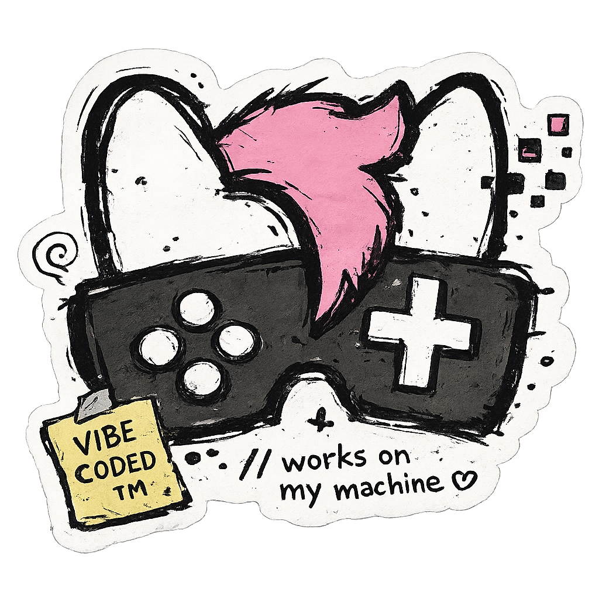

# PowerConnectCli

[](https://github.com/nefarius/PowerConnectCli/actions/workflows/build.yml)
[](https://www.nuget.org/packages/Nefarius.PowerConnect.Ews/)
[](https://www.nuget.org/packages/Nefarius.PowerConnect.CLI/)
[](https://cursor.com/)

`pc28xx` configures a Dell PowerConnect 28xx switch through its built-in web UI.

<br />

> [!NOTE]
> Ahoy, traveler! 👋 This project has been "vibe-coded", meaning that the vast majority of the code has been written with the assistance of AI coding agents. I use my own work in production and value stability and security. Bear in mind, though, that the code you browse might not be an accurate reflection of my personal "style" or taste. The primary goal was to make a useful product, quickly, rather than focus on the development process itself. With that out of the way, if you find it useful, feel free to get inspired by it 😁

## About

The 2816 has no SSH and no documented API. Everything the browser can change is a form post to the GoAhead web server that ships with the Marvell EWS framework. This repository is a client for that interface:

- `Nefarius.PowerConnect.Ews` parses the pages, encodes port-list bitmaps, and turns a change into a before/after plan that is read back after it is applied.
- `pc28xx` is the command-line front end. Writes are printed and wait for confirmation. `--dry-run` never posts. `--yes` skips the prompt.

> [!WARNING]  
> The switch speaks plain HTTP. The password and every setting travel in cleartext on the LAN, and the session cookie is bound to the client IP.

The web UI only allows a few sessions at once. Each command logs out when it finishes; leave a few seconds between commands so the switch can free the previous session.

## Install

`pc28xx` is published as the [`Nefarius.PowerConnect.CLI`](https://www.nuget.org/packages/Nefarius.PowerConnect.CLI/) .NET tool. The .NET 10 SDK is required.

```text
dotnet tool install --global Nefarius.PowerConnect.CLI
dotnet tool update --global Nefarius.PowerConnect.CLI
dotnet tool uninstall --global Nefarius.PowerConnect.CLI
pc28xx --help
```

## Tab completion

Commands, options, and fixed values such as `on`/`off`, port names, speeds, and modes complete through [`dotnet-suggest`](https://www.nuget.org/packages/dotnet-suggest). Install that global tool once, register the `pc28xx` command, and load the shim for your shell. Completion reads the command model only; it does not contact the switch.

```text
dotnet tool install --global dotnet-suggest
```

bash:

```text
dotnet-suggest register --command-path "$(command -v pc28xx)"
dotnet-suggest script bash > ~/.dotnet-suggest-shim.bash
echo '. ~/.dotnet-suggest-shim.bash' >> ~/.bashrc
```

A login shell reads the first existing file among `~/.bash_profile`, `~/.bash_login`, and `~/.profile`, and skips `~/.bashrc`. Source `~/.bashrc` from that file, or append the shim line to the startup file that shell reads.

zsh:

```text
dotnet-suggest register --command-path "$(command -v pc28xx)"
dotnet-suggest script zsh > ~/.dotnet-suggest-shim.zsh
echo '. ~/.dotnet-suggest-shim.zsh' >> ~/.zshrc
```

PowerShell:

```text
dotnet-suggest register --command-path (Get-Command pc28xx).Source
if (-not (Test-Path -Path $PROFILE)) { New-Item -ItemType File -Path $PROFILE -Force }
dotnet-suggest script powershell >> $PROFILE
```

Open a new shell after registering the command and changing the profile. On PowerShell, `$PROFILE` is the file reported by `echo $PROFILE`. Windows Command Prompt has no pluggable completion mechanism, so `pc28xx` cannot complete there.

## Usage

```text
pc28xx --host 192.168.2.17 --user admin vlan list
pc28xx vlan show 20
pc28xx vlan set 20 --tagged g1 --untagged g5
pc28xx port access g5 --vlan 20
pc28xx port set g16 --description spare --speed 100 --duplex full
pc28xx --dry-run snmp community add lab --access ro --station 192.168.2.1
pc28xx config export -o switch.json
pc28xx config diff switch.json
pc28xx config apply switch.json
```

The password comes from `--password` or the `PC28XX_PASSWORD` environment variable. `--json` prints machine-readable output. `--capture-dir` redacts passwords, RADIUS keys, and SNMP community strings in the saved form fields. A capture can still contain the rest of the configuration, so treat the files as sensitive.

On an interactive terminal, `pc28xx` shows a spinner on standard error while it connects, reads, prepares a change, or applies one. The spinner is cleared before the result, the change plan, and confirmation prompts. It stays off for `--json`, `--verbose`, and when standard error is redirected, so scripts and logs stay clean.

`system reset`, `file restore-defaults`, `file download --type firmware|boot`, `secure-mode set unmanaged`, `ip set`, and deleting the user you are logged in as also require `--i-understand`.

### Commands

`vlan`, `vlan port`, `port`, `port access`, `lag`, `lag members`, `green-ethernet`, `storm-control`, `mirror`, `mac-table`, `stp`, `stp port`, `multicast`, `multicast group`, `multicast forward-all`, `igmp-snooping`, `dot1x`, `dot1x hosts`, `dot1x users`, `system`, `ip`, `diag`, `users`, `radius`, `snmp`, `file`, `dhcp-server`, `jumbo-frames`, `stats`, `qos`, `config`, `raw`.

`raw get <page>` and `raw set <page> --set field=value` replay any page the typed commands do not cover. On this firmware QoS `basic` and `advanced` both enable the global QoS mode; `disabled` turns it off.

## Protocol

Login is `POST /config/log_off_page.htm` with `userName$query` and `password$query`. A successful login redirects to `/home.htm` and sets a `UserId` cookie. Logout is `GET /config/log_out.htm`.

Pages are addressed as `/config/<page>.htm?[Table]Query:key=value[Other]Filter:expr`. Fields use a suffix for their role: `$query` is the row on screen, `$add` creates a row, `$repeat?N` is row N of a table, `$scalar` is global, and `$VT` describes the type and range. Row status `1` modifies, `4` creates, and `6` deletes.

Port lists are hex bitmaps. Bit index equals ifIndex minus one, most significant bit first inside each byte. `g1`–`g16` are ifIndex 1–16. `ch1`–`ch8` are ifIndex 1000–1007. `docs/protocol.md` lists the fields captured from a 2816.

## Build

```text
./build.sh Compile
./build.sh Test
./build.sh Pack
./build.sh PublishLinux
./build.sh PublishWindows
```

`./build.sh Pack` writes `Nefarius.PowerConnect.Ews` and `Nefarius.PowerConnect.CLI` to `artifacts/`. A `v*` tag publishes both packages to nuget.org.

Publish profiles under `cli/pc28xx/Properties/PublishProfiles` produce a self-contained single-file binary for `linux-x64` and `win-x64`.

## Tests

The fixtures in `tests/Nefarius.PowerConnect.Ews.Tests/Fixtures` were captured from a live 2816 and then sanitized. Serial number, service tag, MAC addresses, and the password hash were replaced before they were committed.

## Sources & 3rd party credits

This application benefits from these awesome projects ❤ (appearance in no special order):

### Switch web UI

- [AngleSharp](https://github.com/AngleSharp/AngleSharp)

### Command line

- [System.CommandLine](https://github.com/dotnet/command-line-api)
- [Spectre.Console](https://spectreconsole.net/)

### Logging

- [Serilog](https://serilog.net/)
- [Serilog.Sinks.Console](https://github.com/serilog/serilog-sinks-console)

### Build

- [MinVer](https://github.com/adamralph/minver)
- [NUKE](https://nuke.build/)
